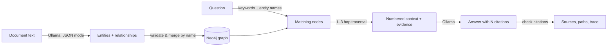

# GraphRAG Knowledge Assistant

**Developed by Dhruv Mittal** · [GitHub profile](https://github.com/Dhruv-ux-dev)

A Streamlit application for knowledge-graph-based retrieval-augmented generation (GraphRAG). It extracts entities and relationships from text with a local Ollama model, stores them in Neo4j, traverses connected entities for multi-hop context, and answers questions with inline citations that trace back to the source passages.

## Features

- **Entity and relationship extraction** from text using a local Ollama model, with validation that tolerates imperfect LLM output.
- **Neo4j graph storage** where the same entity mentioned in several documents becomes one node that remembers every source.
- **Question-to-graph matching** that finds the entities named in a natural-language question, case- and punctuation-insensitively.
- **Multi-hop retrieval** that expands from matched entities across connected nodes (configurable 1–3 hops).
- **Source attribution** mapping each `[N]` citation in the answer to its document, evidence passage and graph path.
- **Execution trace** showing the search terms, matched nodes, traversal paths and the exact context sent to the model.
- **Streamlit dashboard** for ingestion, querying and database statistics.
- **Docker Compose setup** for the app, Neo4j and Ollama, with health checks so the app starts only when its dependencies are ready.

## How it works



1. **Ingest.** The model returns entities and relationships as JSON. Malformed items are skipped rather than failing the whole document, relationship types are normalized (`works for` → `WORKS_FOR`), and each entity stores the passage of the document that mentions it.
2. **Match.** The question is normalized and split into keywords. Nodes whose full name appears in the question rank highest, then nodes whose names contain the keywords. If nothing matches by name, the assistant falls back to entity summaries and source passages.
3. **Traverse.** From each matched node, the graph is explored up to the selected depth, keeping the shortest path to each neighbour and the relationships along it.
4. **Answer.** The model receives numbered context items (entity, relationships, source passage) and must cite them with `[N]`. Citations that don't correspond to a context item are reported in the trace.

## Tech stack

- Python and Streamlit
- Neo4j 5 graph database
- Ollama local inference (default model: `llama3.2`)
- Docker and Docker Compose (optional)

## Run with Docker Compose

Docker Compose starts Neo4j, Ollama and the Streamlit UI.

```bash
# Optional: choose a local password and model first
export NEO4J_PASSWORD='choose-a-local-password'
export OLLAMA_MODEL='llama3.2'
docker compose up --build
```

Open:
- Streamlit UI: http://localhost:8501
- Neo4j Browser: http://localhost:7474

On first start Ollama downloads the model (about 2 GB for `llama3.2`). The app container waits until the download finishes, so the UI can take a few minutes to appear the first time. The model is cached in the `ollama_data` volume for later runs.

To stop:

```bash
docker compose down
```

Graph data is stored in the `neo4j_data` Docker volume. Keep this volume if you want to retain ingested data.

## Run locally

1. Start Neo4j 5 and Ollama.
2. Pull the model:

   ```bash
   ollama pull llama3.2
   ```

3. Install Python dependencies (Python 3.11+):

   ```bash
   python -m venv .venv
   source .venv/bin/activate  # Windows: .venv\Scripts\activate
   pip install -r requirements.txt
   ```

4. Set connection variables if your services don't use the defaults:

   ```bash
   export NEO4J_URI='bolt://127.0.0.1:7687'
   export NEO4J_USER='neo4j'
   export NEO4J_PASSWORD='your-local-neo4j-password'
   export OLLAMA_HOST='http://localhost:11434'
   export OLLAMA_MODEL='llama3.2'
   ```

5. Launch the app:

   ```bash
   streamlit run app.py
   ```

## How to use

1. Open the **Document Ingestion** tab.
2. Choose a sample document or paste your own text, give it a label, then select **Extract & Ingest Nodes**. Ingest both samples to see multi-hop answers that span documents.
3. Open **Ask Assistant** and ask a question, for example *"Who is Dhruv Mittal?"* or *"Who backs the venture?"*.
4. Expand a source to see the evidence passage and graph path behind a citation, or open **Traversal trace** to see how the context was built.
5. Use **Database Status** to view node and relationship counts or clear the graph.

> **Warning:** "Clear Database Graph" deletes every node and relationship in the connected Neo4j database. It requires a confirmation tick; use it only with a database dedicated to this project.

## Tests

```bash
pip install -r requirements-dev.txt
pytest
```

The unit tests cover extraction validation, text normalization, keyword extraction, snippet selection and citation checking. They use stand-ins for Ollama and Neo4j, so no services are needed.

## Project structure

```text
GraphRAG-Knowledge-Assistant/
├── app.py                  # Streamlit UI, extraction, graph store, retrieval and answering
├── .github/workflows/
│   └── tests.yml           # CI: runs the test suite on every push
├── tests/
│   └── test_app.py         # Unit tests (no services required)
├── requirements.txt
├── requirements-dev.txt
├── Dockerfile
├── docker-compose.yml
├── README.md
└── .gitignore
```

## Notes and limitations

- Question matching is keyword- and name-based, not vector similarity search, so questions should mention entities or words that appear in the documents.
- Entities are merged by normalized name. Different spellings of the same entity ("AWS" vs "Amazon Web Services") stay separate nodes.
- Citations are checked against the retrieved context items; this is not an independent fact-checking system.
- Extraction quality depends on the model. Larger models produce cleaner graphs than `llama3.2`.
- Sample demo documents are illustrative examples, not benchmark results.
- Use a non-default Neo4j password outside a throwaway local demo.

## Author

**Dhruv Mittal** · [GitHub](https://github.com/Dhruv-ux-dev)
